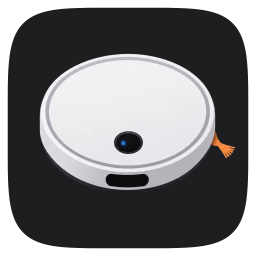
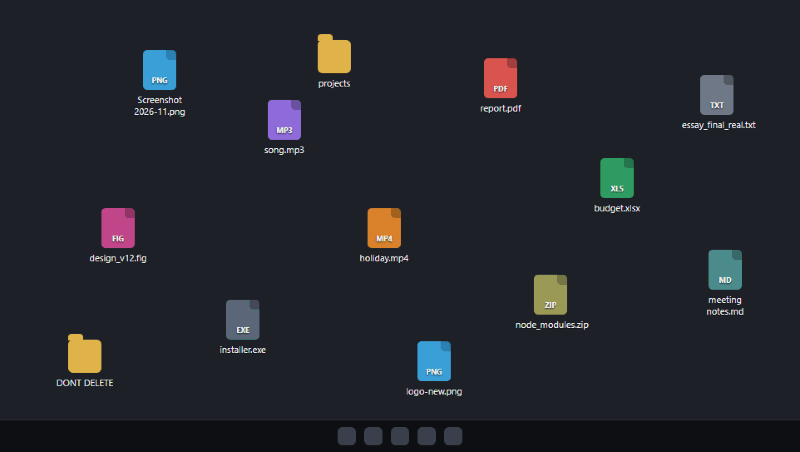

<p align="center">
  
</p>

# DeskSweep

An open-source robot vacuum that tidies your Windows desktop. 🇹🇷 [Türkçe README](README.md)

A little robot rolls over your desktop icons and sweeps the files you chose into a backup folder. **Nothing is ever deleted and every sweep can be undone.**

> **Beta (v0.1):** DeskSweep moves files around. It never deletes anything and every sweep is undoable, but please run **Preview (dry run)** first. Found a bug? [Open an issue](https://github.com/SaylakCreative/DeskSweep-/issues).

<p align="center">
  
</p>

<p align="center"><sub>Recorded on a fake desktop with the real robot animation.</sub></p>

### 🎄 Winter / New Year look

The robot wears a Santa hat, it snows, and swept files turn into gift boxes. Pick it under Settings → Robot → Look; **Seasonal** switches to it automatically from 15 December to 5 January. (Coming in v0.2.0.)

<p align="center">
  
</p>

## Features

- Robot drives to the **real icon positions** (read from Explorer) and sweeps them; it works above the icons but **behind** your other windows.
- Choose which kinds of items to clean (images, music, video, documents, archives, folders, custom types) and edit their extensions.
- **You pick the backup location**: any folder on any drive (default `Desktop\DeskSweep`).
- Safe by design: no deletion, no overwriting, protected names (`*.lnk`, `DONT DELETE`...), dry-run mode, every move journaled for **Undo**.
- English / Türkçe UI, dark / light / system theme, robot speed and colour.
- Automation: start with Windows, sweep at startup or every N hours.
- Closing the window keeps DeskSweep in the system tray.

## Install

Download `DeskSweep-Setup-x.y.z.exe` from [Releases](https://github.com/SaylakCreative/DeskSweep-/releases). The wizard is available in English and Turkish and installs per-user, no admin rights needed.

> The installer is not code-signed yet (see the [Code signing policy](CODE_SIGNING_POLICY.md); an application to the SignPath Foundation program is in progress), so Windows SmartScreen may warn about an unrecognised app: **More info → Run anyway**.

## Run from source

Requires Node.js 20+.

```bash
npm install
npm test
npm run dev:dry   # preview only, nothing is moved
npm start         # settings window + tray icon
npm run dist      # Windows installer in release\
```
## Privacy

DeskSweep collects no data and makes no network connections. Details: [PRIVACY.md](PRIVACY.md).

## Known limits

- Windows only (icon reading and the overlay rely on Win32).
- The robot roams the primary monitor; icons on other monitors send it to the nearest edge.
- If the backup folder is on another drive, items are copied, verified, and only then removed from the desktop.
- "Start with Windows" only works in the installed build.

## Contributing

PRs welcome, see [CONTRIBUTING.md](CONTRIBUTING.md). Good first issues: macOS/Linux support, multi-monitor overlay, new robot skins, code signing. License: MIT.
