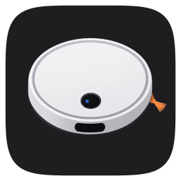
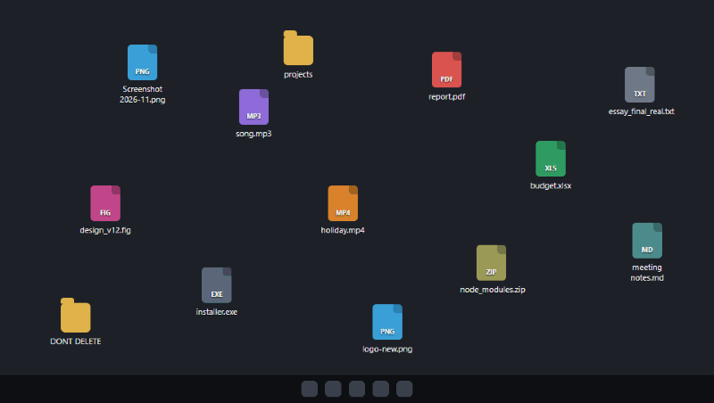
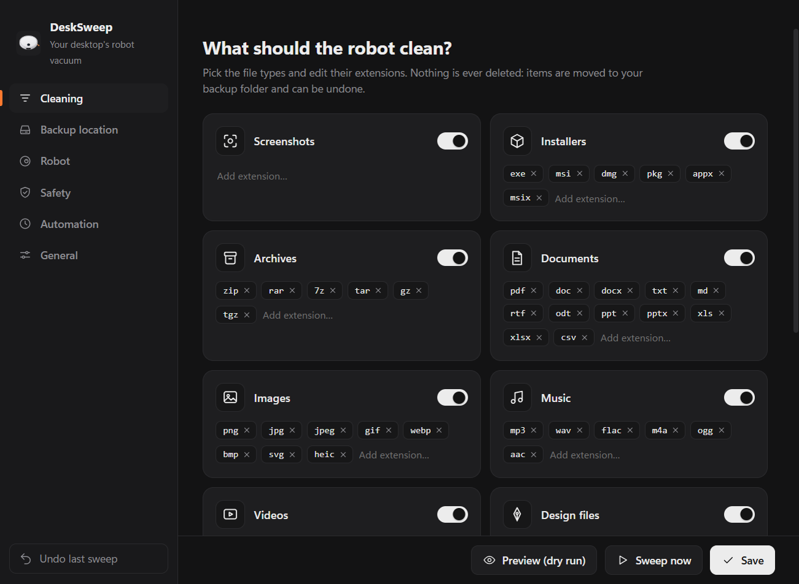
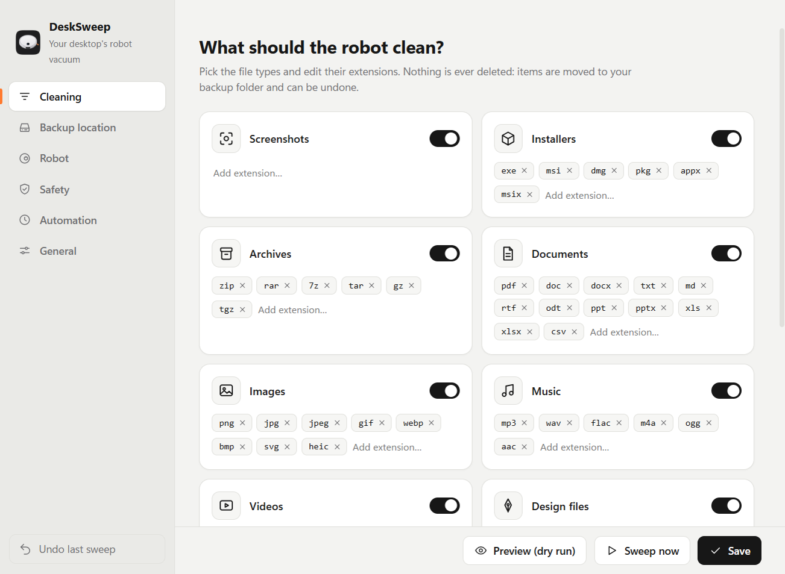
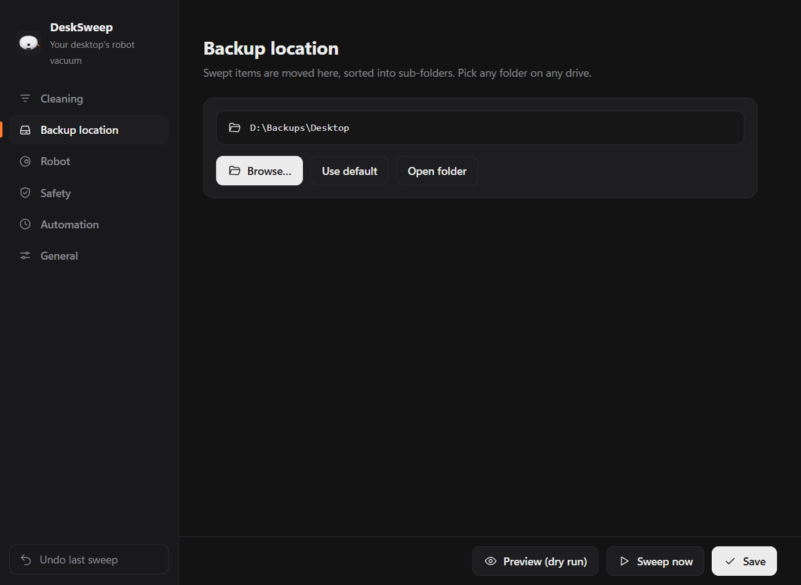
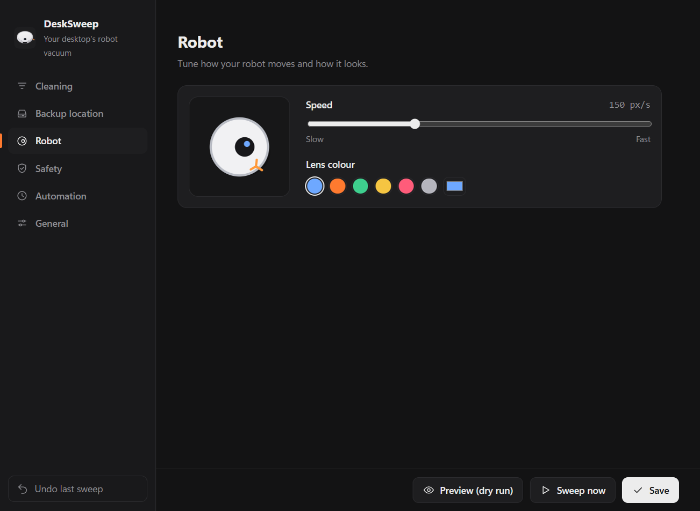

<p align="center">
  
</p>

# DeskSweep

Masaüstünü temizleyen açık kaynaklı robot süpürge. 🇬🇧 [English README](README.en.md)

Fikir, internette dolaşan bir "masaüstü robot süpürgesi" demosundan esinlendi; kod sıfırdan yazıldı, o projeden kod alınmadı.

> **Beta (v0.1):** DeskSweep dosya taşıyan bir araçtır. Hiçbir şeyi silmez ve her süpürme geri alınabilir, ama ilk kullanımda önce **Önizleme (dry run)** ile ne yapacağına bakmanı öneririz. Hata bulursan [issue aç](https://github.com/saylakcreativve/DeskSweep-/issues).

<p align="center">
  
</p>

<p align="center"><sub>Demo, sahte bir masaüstünde gerçek robot animasyonuyla kaydedildi.</sub></p>

## Ekran görüntüleri

| Temizlik kuralları (koyu) | Temizlik kuralları (açık) |
|---|---|
|  |  |
| **Yedek konumu** | **Robot ayarları** |
|  |  |

## Özellikler

| Özellik | Durum |
|---|---|
| Şeffaf, tıklama-geçirgen robot overlay'i (masaüstü kullanılabilir kalır) | ✅ |
| **Gerçek ikon konumları**: Explorer'ın masaüstü listesinden okunur, robot ikonun tam üstüne gider (okunamazsa grid tahmini) | ✅ |
| Robot masaüstünde çalışır: ikonların üstünde, ama diğer uygulama/klasör pencerelerinin **arkasında** | ✅ |
| Pencereyi kapatınca uygulama **sistem tepsisine** küçülür (tepsi simgesine tıklayınca geri gelir, çıkış sağ tık → Çıkış) | ✅ |
| Gerçekçi hareket: yerinde dönüş, yumuşak kalkış/duruş, süpürdüğü yerde toz | ✅ |
| Ayarlar arayüzü, **Türkçe / English**, koyu / açık / sistem teması | ✅ |
| Hangi türlerin (müzik, görsel, video, belge, klasör...) süpürüleceğini ve uzantılarını seçme, özel tür ekleme | ✅ |
| **Yedek konumunu kullanıcı seçer**: herhangi bir klasör/sürücü (varsayılan `Masaüstü\DeskSweep`) | ✅ |
| Robot hızı ve renk ayarı | ✅ |
| **Asla silmez**: öğeler `<Yedek konumu>\<Kategori>` altına taşınır | ✅ |
| Her taşıma anında günlüğe yazılır → tray veya arayüzden **Undo** (çökme olsa bile geri alınır) | ✅ |
| Dry-run (önizleme) modu | ✅ |
| Korunan isimler (`*.lnk`, `DONT DELETE`, klasörler...), minimum dosya yaşı | ✅ |
| Üzerine yazmama, çakışmada `name (1).ext` | ✅ |
| Otomasyon: Windows ile başlat, açılışta veya her N saatte bir otomatik süpür | ✅ |
| Windows kurulum dosyası (NSIS) ve CI yapılandırması (GitHub Actions) | ✅ |
| Birim testleri + gerçek dosyalarla uçtan uca doğrulama | ✅ |

### Bilinen sınırlar

- Yalnızca **Windows** (ikon okuma ve overlay Win32'ye dayanır). macOS/Linux için katkı bekleniyor.
- Robot **ana monitörde** gezer; başka monitördeki ikonlar için en yakın kenara gider.
- Yedek konumu başka bir sürücüdeyse öğe önce kopyalanır, kopya doğrulanır, sonra masaüstündeki orijinal kaldırılır. Kopya başarısız olursa orijinale dokunulmaz.
- Kurulu olmayan (geliştirme) sürümde "Windows ile başlat" devre dışıdır.
- Kategori klasörlerinin diskteki adları İngilizcedir (`Images`, `Music`...).

## Kurulum

[Releases](https://github.com/saylakcreativve/DeskSweep-/releases) sayfasından `DeskSweep-Setup-x.y.z.exe` dosyasını indirip çalıştır. Sihirbaz Türkçe ve İngilizce destekler, kurulum kullanıcı bazlıdır, yönetici izni gerekmez.

> Kurulum dosyası kod imzalı değildir; Windows SmartScreen "tanınmayan uygulama" uyarısı gösterebilir. **Ek bilgi → Yine de çalıştır** ile devam edebilirsin. Güvenmek istemezsen kaynağı okuyup kendin derleyebilirsin (aşağıda).

## Kaynaktan çalıştırma

Node.js 20+ gerekir.

```bash
npm install
npm test
npm run dev:dry   # önizleme, hiçbir şey taşınmaz
npm start         # ayarlar penceresi + tray ikonu
npm run dist      # release\ altında Windows kurulum dosyası
```
Komut satırı: `--dry-run` (önizleme), `--sweep` (hemen süpür), `--background` (sadece tray; Windows ile başlatmada kullanılır).

Ayarlar `%APPDATA%\desksweep\config.json`, geri alma günlüğü aynı klasörde `journal.json` olarak tutulur.

## Mimari

- `src/core` – saf mantık, Electron'a bağımlı değil: `classifier`, `planner` (diske dokunmaz), `journal` (taşıma + undo), `layout`, `iconMatch`, `config`, `i18n`.
- `src/native/desktop-icons.ps1` – Explorer'ın masaüstü listesinden ikon konumlarını okur (salt okunur).
- `src/main` – tray, overlay penceresi, ayarlar penceresi, zamanlama, IPC.
- `src/renderer` – canvas'ta robot animasyonu. `src/settings` – ayarlar arayüzü.

Test için `DESKSWEEP_DESKTOP` ve `DESKSWEEP_USERDATA` ortam değişkenleri masaüstü ve ayar klasörünü geçici klasörlere yönlendirir.

## Güvenlik ilkeleri

Silme yok, üzerine yazma yok, klasörlere dokunma yok (varsayılan), her taşıma anında günlüğe yazılır ve geri alınabilir, config'teki kategori adları hedef klasörün dışına çıkamaz, yedek klasörünün kendisi asla süpürülmez.

## Katkı

PR'lar açık, bkz. [CONTRIBUTING.md](CONTRIBUTING.md). İyi ilk işler: macOS/Linux desteği, çoklu monitör overlay'i, yeni robot görünümleri, kod imzalama. Lisans: MIT.
